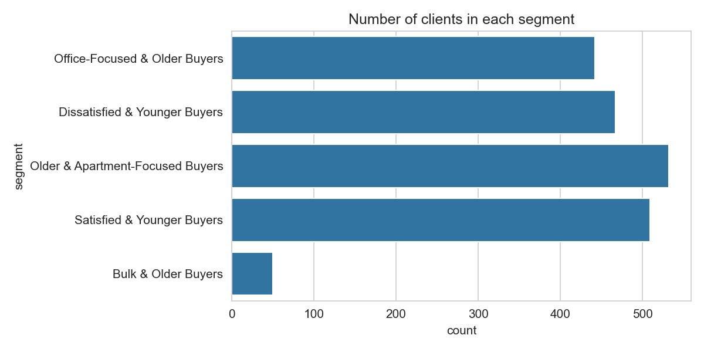
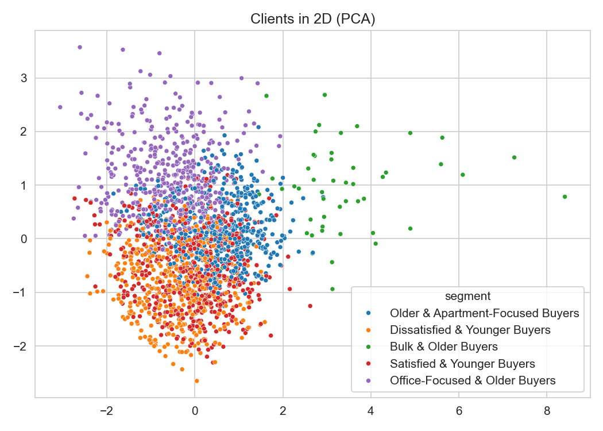
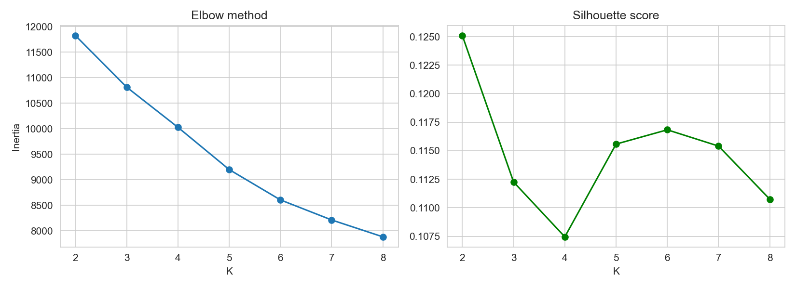
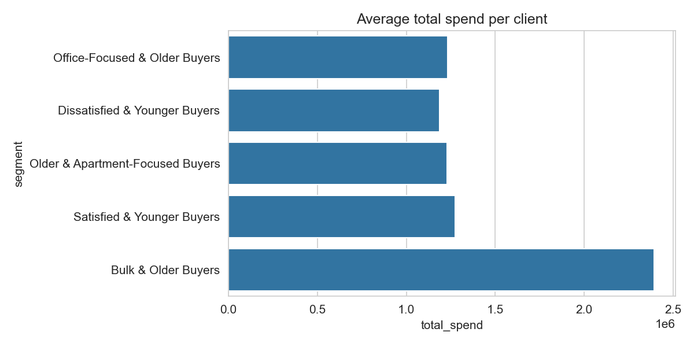

# 🏠 Buyer Segmentation & Investment Profiling for Real Estate Market Intelligence

Machine learning project built for **Parcl Co. Limited** as part of the Unified Mentor Machine Learning Fellowship. It uses **K-Means and hierarchical clustering** to group 2,000 real estate clients into buyer segments, and delivers the results in an interactive **Streamlit dashboard**.

🔗 **Live Dashboard:** [https://YOUR-APP-NAME.streamlit.app](https://YOUR-APP-NAME.streamlit.app)

---

## 📌 Problem

Parcl serves very different buyers (home buyers, investors, companies, international clients) but has no data-driven view of them. Without segmentation, marketing is generic, targeting is poor and investment opportunities are missed.

**Goal:** discover hidden buyer segments and profile them by purchase purpose, geography, loan behaviour and demographics.

---

## 📊 Data

| File | Rows | What it contains |
|---|---|---|
| `clients.csv` | 2,000 | Client type, date of birth, gender, country, region, purchase purpose, satisfaction score, loan applied, referral channel |
| `properties.csv` | 10,000 | Unit listings (Jan 2024 – Dec 2025): tower, unit category, floor area, sale price, status, buyer (`client_ref`) |

**Source:** both files were provided by Unified Mentor as the dataset for this project. They are treated as representative data for Parcl; this project does not verify that the records belong to Parcl's real clients.

The two tables are joined on client ID. From the 7,305 sold units, purchase features were created for each client: **units bought, total spend, average unit price and share of office units**.

---

## 🛠️ Approach

1. **Cleaning** – removed duplicates, standardised labels, converted prices and dates, calculated age from birth year (the date format is mixed).
2. **Encoding** – one-hot encoding for client type, purpose, referral channel and country; label encoding for region (57 values, used in maps).
3. **Scaling** – `StandardScaler` on age, satisfaction, units bought, average unit price and office share.
4. **Choosing K** – elbow method and silhouette score for K = 2 to 8.
5. **Clustering** – K-Means (K = 5), validated with hierarchical clustering (Ward linkage) and a dendrogram.
6. **Interpretation** – every cluster profiled by age, satisfaction, units, price, spend, office share, loan rate, purpose, client type and country. Segment names are generated by a simple rule: the two features where a cluster differs most from the average of all clients (at least 0.3 standard deviations) are used in its name. All features have equal weight in the clustering.
7. **Checks** – Mann-Whitney U tests (Home vs Investment, Individual vs Company, Loan vs No loan), chi-square tests (segment vs purpose and client type) and a stability test (K-Means repeated with 10 random seeds).

---

## 🔑 Key Findings

- **5 buyer segments** were found. The clearest one is **Bulk & Older Buyers**: 50 clients (2.5%) who bought 7.3 units on average and generate **4.75% of total sales value**.
- The other four segments differ mainly in **age, satisfaction and preference for offices or apartments**.
- **Home and Investment buyers behave the same** (both buy 3.65 units on average), so the stated purpose alone does not explain buying behaviour.
- **Statistical tests confirm it:** Home vs Investment, Individual vs Company and Loan vs No-loan clients show no significant difference in units bought, total spend or satisfaction (all p > 0.05).
- The segments **overlap** (silhouette 0.116, agreement between K-Means and hierarchical clustering 0.249), and they are only moderately stable across random starts (average ARI 0.478), so they are a practical grouping rather than sharply separated groups.

| Segment | Clients | Avg age | Avg satisfaction | Avg units | Avg total spend |
|---|---|---|---|---|---|
| Office-Focused & Older Buyers | 442 | 61.0 | 2.97 | 3.37 | $1,232,223 |
| Dissatisfied & Younger Buyers | 467 | 43.9 | 1.52 | 3.60 | $1,187,272 |
| Older & Apartment-Focused Buyers | 532 | 72.4 | 3.16 | 3.64 | $1,229,271 |
| Satisfied & Younger Buyers | 509 | 41.3 | 4.28 | 3.60 | $1,273,122 |
| Bulk & Older Buyers | 50 | 64.4 | 3.54 | 7.32 | $2,393,235 |

---

## 📈 Charts

| | |
|---|---|
|  |  |
|  |  |

---

## 🖥️ Dashboard

- **Segmentation Overview** – cluster distribution and segment shares
- **Investor Behavior** – purpose, loan rate, units, spend and referral channel by segment
- **Geographic Buyer Analysis** – world map, US state map, top regions, segments by country
- **Segment Insights** – descriptive statistics per segment and a closer look at one segment

**Filters:** country, region, acquisition purpose, client type. The segments are created once on all 2,000 clients; the filters only change which clients are shown. The Segment Insights tab lists the clients of a segment with their client IDs for follow-up.

---

## 📁 Repository Structure

```
├── segmentation_analysis.py     # cleaning, encoding, clustering, profiling, charts
├── buyer_streamlit_app.py       # Streamlit dashboard
├── requirements.txt
├── outputs/
│   ├── segmented_clients.csv    # clients with their segment (used by the dashboard)
│   ├── cluster_profile.csv      # profile table of every segment
│   ├── statistical_tests.csv    # test results (Mann-Whitney, chi-square, stability)
│   └── *.png                    # EDA and clustering charts
└── README.md
```

---

## 🚀 Run Locally

```bash
pip install pandas numpy matplotlib seaborn scikit-learn scipy streamlit plotly
python segmentation_analysis.py      # needs clients.csv and properties.csv in the same folder
streamlit run buyer_streamlit_app.py
```

---

## ⚠️ Limitations

- The dataset has no income, first-time buyer or property-use fields, so some segments suggested in the brief (such as Global Investors) could not be confirmed.
- K = 5 was chosen partly for interpretability, because silhouette scores were almost the same for every K, and the clusters are only moderately stable across random starts.
- Segment names describe averages and come from a simple rule, so they are labels for convenience, not confirmed buyer types.
- Findings show associations only, not causes.

---

## 🧰 Tech Stack

Python · Pandas · NumPy · Scikit-learn · SciPy · Matplotlib · Seaborn · Plotly · Streamlit

---

## 👩‍💻 Author

**Tisha Rakholiya** – Machine Learning Intern, Unified Mentor
